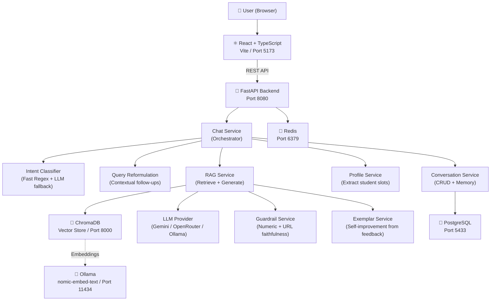
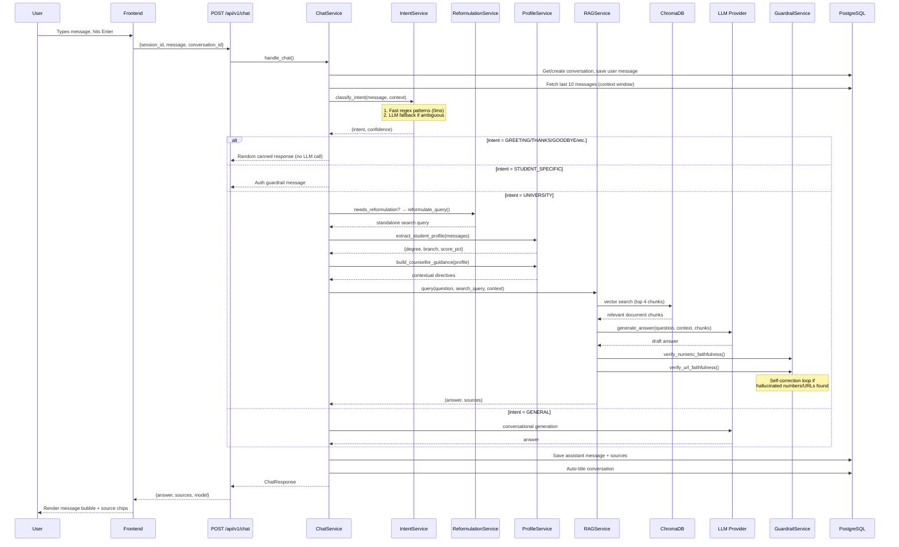

# University AI Companion — System Overview

## What It Is

A **conversational AI chatbot** for SR University students, faculty, and visitors. It answers questions about admissions, courses, hostels, placements, fees, and campus life — all grounded in uploaded university documents via **Retrieval-Augmented Generation (RAG)**.

---

## Architecture at a Glance

---

## Tech Stack

| Layer | Technology |
|-------|-----------|
| **Frontend** | React, TypeScript, Vite, vanilla CSS |
| **Backend** | Python, FastAPI, Pydantic, SQLAlchemy (async) |
| **LLM** | Google Gemini (primary), OpenRouter, Ollama (swappable via [LLMProvider](file:///c:/Users/nikhi/Projects/University-AI/backend/app/providers/base.py) interface) |
| **Embeddings** | Ollama `nomic-embed-text` via [OllamaEmbeddingProvider](file:///c:/Users/nikhi/Projects/University-AI/backend/app/providers/embedding_ollama.py) |
| **Vector DB** | ChromaDB (cosine similarity) |
| **Relational DB** | PostgreSQL (conversations, messages, documents, feedback) |
| **Cache** | Redis |
| **Migrations** | Alembic |
| **Infrastructure** | Docker Compose (PG, ChromaDB, Redis) |

---

## Request Flow (End-to-End)

When a user sends a message, here's exactly what happens:

---

## Key Backend Services

### 1. [ChatService](file:///c:/Users/nikhi/Projects/University-AI/backend/app/services/chat_service.py) — The Orchestrator
- Entry point for all user messages
- Routes to the correct handler based on intent classification
- Manages fast conversational responses (greetings, thanks, goodbye) without LLM calls

### 2. [IntentService](file:///c:/Users/nikhi/Projects/University-AI/backend/app/services/intent_service.py) — Hybrid Classification
- **Fast path** (0ms): Regex patterns for greetings, goodbyes, acknowledgments, scores, affirmatives
- **LLM fallback**: For ambiguous messages, uses the [classifier prompt](file:///c:/Users/nikhi/Projects/University-AI/prompts/classifier.md) → JSON response
- **10 intent types**: `GREETING`, `GOODBYE`, `THANKS`, `HOW_ARE_YOU`, `ACKNOWLEDGMENT`, `HELP`, `STUDENT_SPECIFIC`, `UNIVERSITY`, `GENERAL_CONVERSATION`, `UNKNOWN`
- **Guardrail**: Prevents false `STUDENT_SPECIFIC` classification for score-sharing messages

### 3. [ReformulationService](file:///c:/Users/nikhi/Projects/University-AI/backend/app/services/reformulation_service.py) — Context Resolution
- Detects when a follow-up needs coreference resolution (pronouns, continuations, slang)
- Expands abbreviations (`plcmnt` → `placement`, `elgblty` → `eligibility`)
- Converts "yes" / "tell me more" into standalone search queries using conversation history

### 4. [RAGService](file:///c:/Users/nikhi/Projects/University-AI/backend/app/services/rag_service.py) — Retrieve & Generate
- **Retrieve**: Vector search in ChromaDB using Ollama embeddings, filters by max cosine distance (0.5)
- **Generate**: Renders the [RAG prompt](file:///c:/Users/nikhi/Projects/University-AI/prompts/rag.md) with evidence, question, conversation context, and exemplars
- **Context enrichment**: Short affirmative follow-ups ("yes") are enriched with the reformulated search query
- **Self-correction loop**: If hallucinated numbers are detected, re-prompts the LLM with correction instructions

### 5. [ProfileService](file:///c:/Users/nikhi/Projects/University-AI/backend/app/services/profile_service.py) — Student Slot Extraction
- Scans all user messages to extract: degree (B.Tech/M.Tech/MBA/...), branch (CSE/ECE/...), and board scores
- Builds dynamic counsellor guidance injected into the RAG context
- Prevents re-asking for information the student already provided

### 6. [GuardrailService](file:///c:/Users/nikhi/Projects/University-AI/backend/app/services/guardrail_service.py) — Hallucination Detection
- **Numeric faithfulness**: Verifies all percentages/numbers in the answer exist in evidence or user context
- **URL faithfulness**: Checks all URLs are grounded in evidence, sanitizes fabricated portal links
- **Retrieval confidence**: Validates at least one chunk has strong semantic similarity

### 7. [ConversationService](file:///c:/Users/nikhi/Projects/University-AI/backend/app/services/conversation_service.py) — Memory & Feedback
- CRUD for conversations and messages (PostgreSQL)
- Session-based ownership (browser-generated UUID)
- Feedback system with self-improvement: thumbs-up answers become exemplars for future responses

### 8. [IngestionService](file:///c:/Users/nikhi/Projects/University-AI/backend/app/services/ingestion_service.py) — Document Pipeline
- Supports PDF, TXT, MD, DOCX
- Pipeline: validate → checksum → save → extract text → chunk (250 words, 40 word overlap) → embed → store in ChromaDB
- Section-aware chunking with paragraph and markdown heading boundaries

---

## LLM Provider System

The [LLMProvider](file:///c:/Users/nikhi/Projects/University-AI/backend/app/providers/base.py) abstract base class defines `generate()` and `stream()`. Three implementations:

| Provider | File | Notes |
|----------|------|-------|
| [GeminiProvider](file:///c:/Users/nikhi/Projects/University-AI/backend/app/providers/gemini.py) | `gemini.py` | **Primary**. Auto-fallback through 6 Gemini model variants on 429/503. Legacy model auto-upgrade. |
| [OpenRouterProvider](file:///c:/Users/nikhi/Projects/University-AI/backend/app/providers/openrouter.py) | `openrouter.py` | OpenAI-compatible API. Supports free models. |
| [OllamaProvider](file:///c:/Users/nikhi/Projects/University-AI/backend/app/providers/ollama.py) | `ollama.py` | Local inference via Ollama. |

The [factory](file:///c:/Users/nikhi/Projects/University-AI/backend/app/providers/factory.py) creates the correct provider based on `LLM_PROVIDER` in [.env](file:///c:/Users/nikhi/Projects/University-AI/backend/.env).

---

## Prompt System

All prompts are versioned under [`prompts/`](file:///c:/Users/nikhi/Projects/University-AI/prompts) and loaded via [prompt_service.py](file:///c:/Users/nikhi/Projects/University-AI/backend/app/services/prompt_service.py):

| Prompt | Purpose |
|--------|---------|
| [`system.md`](file:///c:/Users/nikhi/Projects/University-AI/prompts/system.md) | Base personality, tone, core rules |
| [`rag.md`](file:///c:/Users/nikhi/Projects/University-AI/prompts/rag.md) | RAG answer generation — conciseness, anti-repetition, eligibility math, anti-hallucination |
| [`classifier.md`](file:///c:/Users/nikhi/Projects/University-AI/prompts/classifier.md) | Intent classification → JSON output |
| [`reformulation.md`](file:///c:/Users/nikhi/Projects/University-AI/prompts/reformulation.md) | Follow-up → standalone search query |

---

## Frontend Structure

| Component | Purpose |
|-----------|---------|
| [ChatPage](file:///c:/Users/nikhi/Projects/University-AI/frontend/src/pages/ChatPage.tsx) | Main chat view — sidebar + message area + input |
| [AdminPage](file:///c:/Users/nikhi/Projects/University-AI/frontend/src/pages/AdminPage.tsx) | Document management, stats, feedback review |
| [ChatInput](file:///c:/Users/nikhi/Projects/University-AI/frontend/src/components/ChatInput.tsx) | Auto-growing textarea, always-focused, global keydown capture |
| [MessageBubble](file:///c:/Users/nikhi/Projects/University-AI/frontend/src/components/MessageBubble.tsx) | User/assistant message rendering with source chips + feedback |
| [ConversationList](file:///c:/Users/nikhi/Projects/University-AI/frontend/src/components/ConversationList.tsx) | Sidebar conversation history |
| [api.ts](file:///c:/Users/nikhi/Projects/University-AI/frontend/src/services/api.ts) | REST API client (chat, conversations, admin, feedback) |

---

## Database Models

| Model | Table | Purpose |
|-------|-------|---------|
| [Conversation](file:///c:/Users/nikhi/Projects/University-AI/backend/app/models/conversation.py) | `conversations` | Session-based conversation tracking |
| [Message](file:///c:/Users/nikhi/Projects/University-AI/backend/app/models/message.py) | `messages` | Individual messages with role, content, model, sources |
| [Document](file:///c:/Users/nikhi/Projects/University-AI/backend/app/models/document.py) | `documents` | Uploaded knowledge base documents |
| [DocumentVersion](file:///c:/Users/nikhi/Projects/University-AI/backend/app/models/document.py) | `document_versions` | Versioned document storage with checksums |
| [Feedback](file:///c:/Users/nikhi/Projects/University-AI/backend/app/models/feedback.py) | `feedback` | Thumbs up/down ratings per message |

---

## API Endpoints

### Chat (Public)
| Method | Path | Purpose |
|--------|------|---------|
| `POST` | `/api/v1/chat` | Send message, get AI response |
| `GET` | `/api/v1/conversations` | List session conversations |
| `GET` | `/api/v1/conversations/{id}` | Get conversation with messages |
| `DELETE` | `/api/v1/conversations/{id}` | Delete a conversation |
| `POST` | `/api/v1/feedback` | Submit thumbs up/down |

### Admin (Protected via `X-Admin-Key` header)
| Method | Path | Purpose |
|--------|------|---------|
| `GET` | `/api/v1/admin/stats` | Dashboard statistics |
| `GET` | `/api/v1/admin/documents` | List all documents |
| `POST` | `/api/v1/admin/documents` | Upload + ingest document |
| `DELETE` | `/api/v1/admin/documents/{id}` | Deactivate document |
| `GET` | `/api/v1/admin/feedback` | View all user feedback |

---

## Current Configuration

From [`.env`](file:///c:/Users/nikhi/Projects/University-AI/backend/.env):
- **LLM Provider**: Gemini (primary model: `gemini-3.5-flash-lite`, with auto-fallback)
- **Embedding**: Ollama `nomic-embed-text`
- **Database**: PostgreSQL on port 5433
- **ChromaDB**: Port 8000
- **Redis**: Port 6379

---

## Test Suite

56 tests across 12 test files — all passing. Covers:
- API endpoints, chat routing, intent classification
- Gemini/OpenRouter providers, guardrails, ingestion
- Profile extraction, prompt rendering, query reformulation, exemplar service
